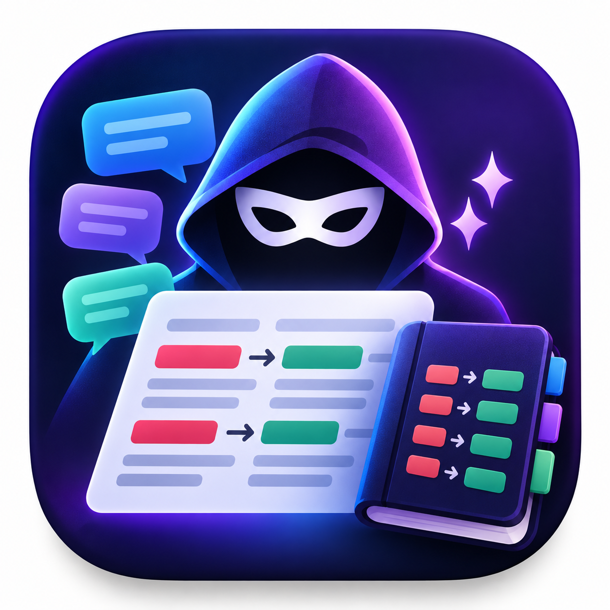

<p align="center"></p>

# AnonymAI

Chat con modelli LLM a tier gratuito che **anonimizza i messaggi prima dell'invio**: definisci una lista di filtri `testo → sostituto` (nomi, aziende, indirizzi…) e il modello riceve solo il testo già sostituito.

Tutto gira nel browser: nessun server, nessun account. API key, configurazione e cronologia chat restano sul dispositivo dell'utente.

## Funzionalità

- Provider con endpoint compatibile OpenAI: OpenRouter (modelli `:free`), Groq, Google Gemini; endpoint modificabili.
- Modelli salvati per provider, scelti da una tendina; elenco dei modelli disponibili caricabile dall'API.
- Filtri persistenti, case-insensitive; le stringhe più lunghe hanno la precedenza.
- Cronologia chat salvata in IndexedDB. La chat contiene solo testo già filtrato.
- Export/import in JSON di configurazione e chat (validati all'import).

## Sviluppo

```sh
npm install
npm run dev        # http://localhost:5173
npm test
npm run build      # output statico in dist/
```

## Versioni

Formato `VERSIONE.MAJOR.MINOR`, unica fonte il campo `version` di `package.json` (mostrato nell'interfaccia).

| Comando                   | Quando                                   | Esempio          |
|---------------------------|------------------------------------------|------------------|
| `npm run release:version` | nuova versione del prodotto, cambi radicali | `0.4.2 → 1.0.0` |
| `npm run release:major`   | nuove funzionalità                       | `0.4.2 → 0.5.0`  |
| `npm run release:minor`   | correzioni e piccoli ritocchi            | `0.4.2 → 0.4.3`  |

In un repo git ogni comando crea anche il commit e il tag `vX.Y.Z`.

## Deploy

- **GitHub Pages**: il workflow `.github/workflows/deploy.yml` pubblica a ogni push su `main`. Nel repo: *Settings → Pages → Source: GitHub Actions*.
- **Netlify / Vercel**: importa il repo; build command `npm run build`, output `dist`. Nessuna configurazione aggiuntiva.

## Struttura

```
assets/                 immagine sorgente dell'icona (alta risoluzione)
public/                 favicon, apple-touch-icon e logo ottimizzati, serviti così come sono
scripts/icons.py        rigenera public/ dall'icona sorgente (python scripts/icons.py, richiede Pillow)
src/
  schemas.ts            tipi + validazione (zod)
  config/defaults.ts    provider predefiniti
  lib/                  logica pura: filtri, client API, backup
  store/                stato persistente: settings (localStorage), chats (IndexedDB)
  components/           UI React
  */__test__/           test (vitest), accanto al codice che verificano
```

## Privacy

Le API key sono salvate in chiaro nel `localStorage` del browser e inviate solo all'endpoint del provider scelto. Il file di export della configurazione le contiene: non condividerlo.

## Licenza

MIT
